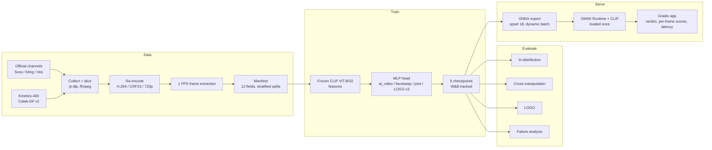

# DeepTrace

**Evaluating and serving a deepfake / AI-generated video detector under distribution shift**

DeepTrace is an end-to-end applied-ML project covering the full model lifecycle: dataset curation → training of multiple model variants → out-of-distribution evaluation protocols → ONNX export → a latency-instrumented inference service with a Gradio front end.

The central question is an evaluation question: *does a detector that scores well in-distribution still work when the generator or manipulation type changes?* Our answer is "mostly no, unless you train for it", and the repo contains the protocols, numbers, and caveats to back that up.

---

## TL;DR

| | |
|---|---|
| **Problem** | Detectors trained on face-swap data (FaceForensics++, Celeb-DF) are evaluated in-distribution and silently fail on whole-scene video generators (Sora, Kling, Veo). |
| **Data** | Built **DeepTrace-GV**: 246 clips (116 generated, 130 real), 12 metadata fields per clip, generator-stratified 70/15/15 splits, documented with a Gebru-style [datasheet](data/datasheet/DATASHEET.md). |
| **Evaluation** | Two OOD protocols: **cross-manipulation** (train on one manipulation type, test on the other) and **leave-one-generator-out (LOGO)**. |
| **Key finding** | Cross-manipulation transfer is near chance (AUC **0.44–0.54** for a CLIP linear probe; **0.50** for our AI-video-only model on Celeb-DF v2). Joint training recovers both domains. |
| **Model** | Frozen CLIP ViT-B/32 backbone + 2-layer MLP head (512→128→2). Only ~66K trainable parameters, so variants are cheap to train, version, and swap. |
| **Serving** | MLP heads exported to ONNX (opset 18, dynamic batch axis) and served with ONNX Runtime; backbone and head are loaded once and reused across requests. Model forward pass: **16.5 ± 1.6 ms per 5-frame clip** on a T4. |
| **Quality** | 26 unit tests across the data pipeline, model modules, metrics, and demo pipeline. |

---

## System overview



---

## Evaluation methodology

Most of the engineering effort went into making the evaluation trustworthy rather than making the headline number large.

**Leakage control.** Every clip, real and generated, is re-encoded to the same codec, CRF, and resolution before any processing. Without this, a classifier can separate sources by compression fingerprint instead of generation artifacts. The same normalisation is applied at inference time so the served model sees the training distribution.

**Stratified, documented splits.** Splits are stratified by generator and recorded in the manifest, so every result is reproducible from a single CSV. The dataset ships with a datasheet that lists known selection biases (official demo reels are curated, community clips are few).

**Protocols.**

| Protocol | What it measures | Implementation |
|---|---|---|
| In-distribution | Ceiling on each domain | `evaluate.py` |
| Cross-manipulation | Transfer between face-swap and whole-scene generation; reported as an **AUC gap** | `evaluate.py --cross-manipulation` |
| LOGO | Generalisation to an unseen generator (3 rounds, one per generator) | `logo_eval.py --all-rounds` |
| Failure analysis | Highest-confidence errors for qualitative review | `evaluate.py --failure-analysis` |

**Metrics.** AUC-ROC is primary (threshold-free, robust to the real/fake imbalance); accuracy, precision, recall, F1, confusion matrices, and per-generator AUC are reported alongside. Metric code lives in `src/evaluation/metrics.py` and is unit-tested.

**Baseline.** Every DeepTrace number is compared against a CLIP linear probe (Ojha et al., CVPR 2023) trained and tested under identical splits.

---

## Results

### Cross-manipulation (DeepTrace, CLIP + MLP)

| Training data | DeepTrace-GV AUC | Celeb-DF v2 AUC | Gap |
|---|---|---|---|
| AI-video only | 0.971 | **0.497** | 0.474 |
| Face-swap only | 0.722 | 0.809 | 0.087 |
| Joint | 1.000 | 0.821 | – |

Training only on generated video produces a chance-level face-swap detector. Joint training keeps generated-video performance and recovers Celeb-DF v2 performance.

### Cross-manipulation (CLIP linear-probe baseline)

| Experiment | AUC |
|---|---|
| In-distribution, AI-generated | 1.000 |
| Train AI → test face-swap | **0.437** |
| Train face-swap → test AI | **0.541** |
| Joint → DeepTrace-GV | 0.977 |
| Joint → Celeb-DF v2 | 0.954 |

The same failure pattern appears with a different head, which suggests the gap comes from the data rather than from our architecture.

### Leave-one-generator-out (joint model)

| Held-out generator | Test clips (fake / real) | AUC | Accuracy |
|---|---|---|---|
| Sora | 5 / 19 | 1.000 | 100.0% |
| Kling | 7 / 19 | 0.985 | 88.5% |
| Veo | 6 / 19 | 0.939 | 88.0% |
| **Mean ± std** | | **0.975 ± 0.026** | |

Veo is consistently the hardest generator to detect when held out.

### Inference latency (T4 GPU)

| Measurement | Value |
|---|---|
| Model forward pass (CLIP + head, 5 frames, warm, 100 runs) | 16.5 ± 1.6 ms per clip |
| Same, with the head served by ONNX Runtime on CPU | 14.2 ± 2.3 ms per clip |
| Frame throughput | ~300 frames/s |

These figures cover **model compute only** on pre-decoded 224×224 frames, after 5 warm-up runs. End-to-end latency in the demo also includes ffmpeg re-encoding and frame extraction, which dominate for typical clip lengths; the demo reports this full wall-clock time per request.

### Limitations

These are reported so the numbers above are read correctly.

- **Small test sets.** DeepTrace-GV test split is 37 clips; LOGO rounds have 24–26 clips with only 5–7 fakes each. A single clip moves AUC by several points, so AUC = 1.000 should be read as "no errors on a small sample", not as a solved problem. Results are exploratory.
- **No confidence intervals yet.** Bootstrap CIs over per-clip predictions are the next addition (see roadmap).
- **Different Celeb-DF v2 test sizes.** The baseline was evaluated on 518 Celeb-DF clips and DeepTrace on 104, so the two tables are not a strict head-to-head on that column.
- **Curated sources.** Many generated clips come from official showcase reels, which are higher quality than typical user outputs.

---

## Inference service

```
upload → validate → ffmpeg re-encode (H.264/CRF23/720p, 5 min timeout)
       → 1 FPS frame extraction → CLIP ViT-B/32 features
       → ONNX Runtime MLP head → per-frame P(fake) → mean aggregation → verdict
```

Design choices relevant to serving:

- **Frozen backbone, swappable heads.** The backbone is shared; each variant is a small ONNX file (`ai_video`, `faceswap`, `joint`). Switching or rolling back a model means swapping a few hundred KB, not redeploying a backbone.
- **Load once, reuse.** CLIP and the ONNX session are initialised once per process and reused across requests.
- **Dynamic batch axis.** The ONNX head accepts any number of frames, so clip length does not require re-export.
- **Same preprocessing in training and serving.** Re-encoding is part of the inference path, not only the training path, which removes a common source of train/serve skew.
- **Defensive pipeline.** Input validation, an ffmpeg presence check, subprocess timeouts, temporary-directory cleanup, and typed errors (`DemoPipelineError`) surfaced to the UI.
- **Observability.** Each request returns end-to-end latency, clips/s, and frames/s alongside the verdict.

The UI shows the verdict with a confidence score, a configurable decision threshold (default 0.5), and per-frame fake probabilities so a reviewer can see *where* in the clip the model reacted.

```bash
python src/demo/app.py      # http://localhost:7860, uses models/onnx/
```

---

## Model variants

| Checkpoint | Training data | Purpose |
|---|---|---|
| `deeptrace_ai_video_full_best.pth` | DeepTrace-GV | Cross-manipulation (AI → face-swap) |
| `deeptrace_faceswap_full_best.pth` | Celeb-DF v2 | Cross-manipulation (face-swap → AI) |
| `deeptrace_joint_full_best.pth` | Both | Primary model, served in the demo |
| `deeptrace_joint_{sora,kling,veo}_best.pth` | Both, one generator held out | LOGO rounds |

All variants share the same hyperparameters (`configs/config.yaml`): AdamW, lr 1e-4, weight decay 1e-4, cosine schedule, batch 32, up to 20 epochs with early stopping on validation AUC (patience 5), seed 42. Runs are tracked in Weights & Biases.

Validation AUC at the selected checkpoint: AI-video 0.994, face-swap 0.834, joint 0.896.

---

## Reproducing

### Setup

```bash
git clone <repo-url> && cd deeptrace
pip install -r requirements.txt
brew install ffmpeg            # or apt-get install ffmpeg
```

Training was run on a single NVIDIA T4 (Colab Pro / Kaggle). The full notebook is `notebooks/DeepTrace_Training.ipynb`, which also performs the ONNX export.

### Data

DeepTrace-GV manifest: `data/manifests/staging_manifest.csv`. Video files are hosted on [Kaggle](https://www.kaggle.com/datasets/tavishh/deeptrace-gv/); collection and slicing scripts are in `data/scripts/`.

Celeb-DF v2 is needed only for face-swap and joint training and for cross-manipulation evaluation. DeepTrace-GV evaluation and the demo work without it.

```python
import gdown, zipfile, os
gdown.download("https://drive.google.com/uc?id=1xCjVCEEPY78SpxlOeqfpDcBpb0lqXger",
               "data/celebdf/Celeb-DF-v2.zip")
with zipfile.ZipFile("data/celebdf/Celeb-DF-v2.zip") as z:
    z.extractall("data/celebdf/")
os.remove("data/celebdf/Celeb-DF-v2.zip")
```

### Pipeline

```bash
python src/data_pipeline/reencode.py        --input data/raw       --output data/reencoded
python src/data_pipeline/extract_frames.py  --input data/reencoded --output data/frames
python src/data_pipeline/annotate_ai_clips.py --manifest data/manifests/staging_manifest.csv
python src/data_pipeline/assign_splits.py     --manifest data/manifests/staging_manifest.csv
```

### Train

```bash
COMMON="--manifest data/manifests/staging_manifest.csv --deeptrace-root data/reencoded \
        --celebdf-root data/celebdf --checkpoint-dir models/checkpoints"

python src/model/train.py --mode ai_video $COMMON
python src/model/train.py --mode faceswap $COMMON
python src/model/train.py --mode joint    $COMMON
for g in sora kling veo; do python src/model/train.py --mode joint --logo-held-out $g $COMMON; done
```

### Evaluate

```bash
python src/evaluation/evaluate.py --model deeptrace --cross-manipulation \
    --checkpoint-dir models/checkpoints --manifest data/manifests/staging_manifest.csv \
    --deeptrace-root data/reencoded --celebdf-root data/celebdf

python src/evaluation/logo_eval.py --model deeptrace --all-rounds --checkpoint-dir models/checkpoints

python src/evaluation/evaluate.py --model deeptrace --failure-analysis \
    --checkpoint models/checkpoints/deeptrace_joint_full_best.pth

python src/evaluation/evaluate.py --model deeptrace --speed-benchmark \
    --checkpoint models/checkpoints/deeptrace_joint_full_best.pth
```

Result JSONs are written to `data/results/`.

### Test

```bash
python -m pytest tests/ -v     # 26 tests
```

---

## Repository layout

```
src/
├── data_pipeline/   collection, re-encoding, frame extraction, face preprocessing,
│                    split assignment, difficulty-annotation and Cohen's kappa tooling
├── model/           CLIP extractor, MLP head, training loop (all modes + LOGO), ONNX export
├── evaluation/      metrics, cross-manipulation, LOGO, failure analysis, speed benchmark
└── demo/            inference pipeline + Gradio app
data/
├── manifests/       DeepTrace-GV manifest (246 clips, 12 fields)
├── datasheet/       dataset datasheet
├── results/         all reported numbers as JSON
├── scripts/         download and slicing scripts
└── difficulty_annotation/   rating sheets for the human-difficulty study
models/
├── checkpoints/     6 trained variants
└── onnx/            3 exported heads + latency benchmark
configs/config.yaml  hyperparameters and paths
notebooks/           end-to-end Colab training notebook
tests/               unit tests
```

---

## Roadmap

Ordered by how much each item would change confidence in the conclusions.

1. **Bootstrap confidence intervals** on every AUC, and a larger held-out test set per generator.
2. **Full latency breakdown** (decode / re-encode / extraction / backbone / head) with p50/p95/p99, and a fully ONNX or TensorRT backbone to compare against the PyTorch path.
3. **Calibration** (ECE, reliability diagrams), since the demo exposes a user-facing threshold.
4. **Human-difficulty study.** Rating tooling and Cohen's kappa computation are implemented; annotation of the 60-clip subset is pending. This will let us report detector accuracy stratified by how hard a clip is for humans.
5. **Multimodal-LLM baseline.** Evaluate a vision-language model as a zero-shot judge under the same cross-manipulation and LOGO protocols, to test whether general-purpose models close the generalisation gap.
6. **Newer generators** added as additional LOGO rounds.

---

## Author

**[Your Name]**: sole developer. Designed and implemented the full codebase: data collection and preprocessing pipeline, dataset curation, training, evaluation protocols, ONNX export, and the inference service.

Originally developed as the course project for CS 5330 Pattern Recognition and Computer Vision, Northeastern University, 2026.

---

## References

1. Rössler et al., *FaceForensics++*, ICCV 2019
2. Ojha et al., *Towards Universal Fake Image Detection*, CVPR 2023
3. Li et al., *Celeb-DF*, CVPR 2020
4. Khan et al., *CLIP-based Deepfake Detection*, ECCV 2024
5. Chandra et al., *Deepfake-Eval-2024*, arXiv 2025
6. Ni et al., *GenVidBench*, AAAI 2026
7. Kundu et al., *UNITE*, arXiv 2024
8. Gebru et al., *Datasheets for Datasets*, CACM 2021

## Citation

```bibtex
@misc{deeptrace2026,
  title  = {DeepTrace: Deepfake and AI-Generated Video Detection
            with Cross-Manipulation Generalization Analysis},
  author = {[Your Name]},
  year   = {2026}
}
```
